# Windows Event Log poster

A threat hunter's field reference for the Windows event log, as an 18 × 24 in wall poster in twelve colour themes. Every theme carries the same content; pick the one you want on your wall.

**[Open the preview page](https://bm16-gh.github.io/windowseventlogposter/)** to browse the themes and download print files.

<table>
<tr><td align="center" width="25%"><a href="posters/18x24/Windows-Event-Log_00-Hunt-Console_18x24_300dpi.png">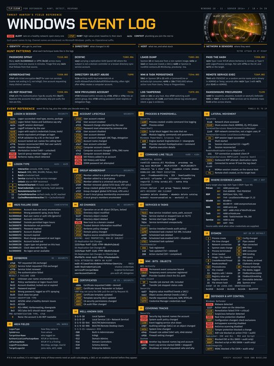</a> <b>00 · Hunt Console</b> The original. Charcoal console with amber and red. <a href="posters/18x24/Windows-Event-Log_00-Hunt-Console_18x24_300dpi.png">18×24</a> · <a href="posters/20x24/Windows-Event-Log_00-Hunt-Console_20x24_300dpi.png">20×24</a> · <a href="posters/20x30/Windows-Event-Log_00-Hunt-Console_20x30_300dpi.png">20×30</a></td><td align="center" width="25%"><a href="posters/18x24/Windows-Event-Log_01-Phosphor_18x24_300dpi.png">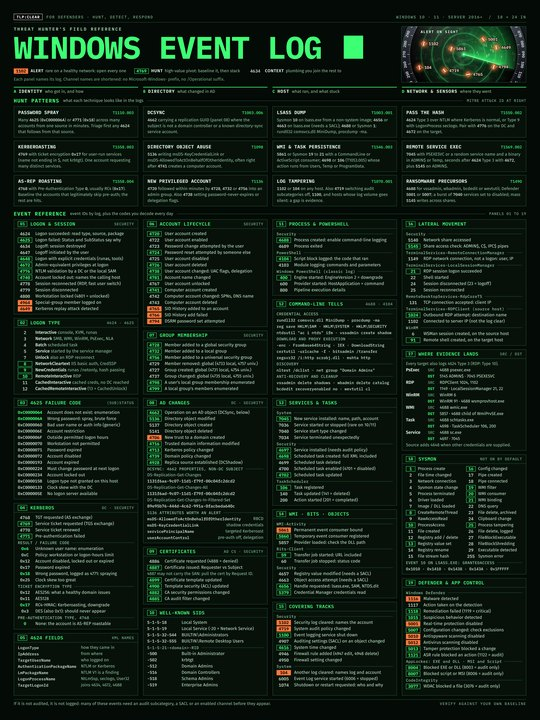</a> <b>01 · Phosphor</b> Green-screen terminal, monospace throughout. <a href="posters/18x24/Windows-Event-Log_01-Phosphor_18x24_300dpi.png">18×24</a> · <a href="posters/20x24/Windows-Event-Log_01-Phosphor_20x24_300dpi.png">20×24</a> · <a href="posters/20x30/Windows-Event-Log_01-Phosphor_20x30_300dpi.png">20×30</a></td><td align="center" width="25%"><a href="posters/18x24/Windows-Event-Log_02-Blue-Team_18x24_300dpi.png">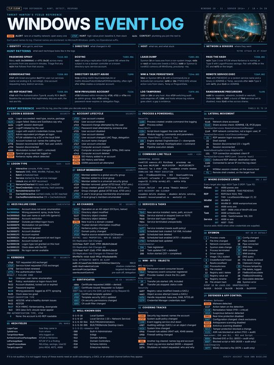</a> <b>02 · Blue Team</b> Deep navy with cyan, orange for alerts. <a href="posters/18x24/Windows-Event-Log_02-Blue-Team_18x24_300dpi.png">18×24</a> · <a href="posters/20x24/Windows-Event-Log_02-Blue-Team_20x24_300dpi.png">20×24</a> · <a href="posters/20x30/Windows-Event-Log_02-Blue-Team_20x30_300dpi.png">20×30</a></td><td align="center" width="25%"><a href="posters/18x24/Windows-Event-Log_03-Redline_18x24_300dpi.png">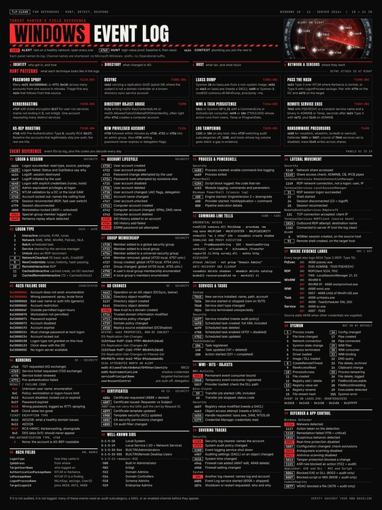</a> <b>03 · Redline</b> Black and red under a hazard stripe. <a href="posters/18x24/Windows-Event-Log_03-Redline_18x24_300dpi.png">18×24</a> · <a href="posters/20x24/Windows-Event-Log_03-Redline_20x24_300dpi.png">20×24</a> · <a href="posters/20x30/Windows-Event-Log_03-Redline_20x30_300dpi.png">20×30</a></td></tr>
<tr><td align="center" width="25%"><a href="posters/18x24/Windows-Event-Log_04-Blueprint_18x24_300dpi.png">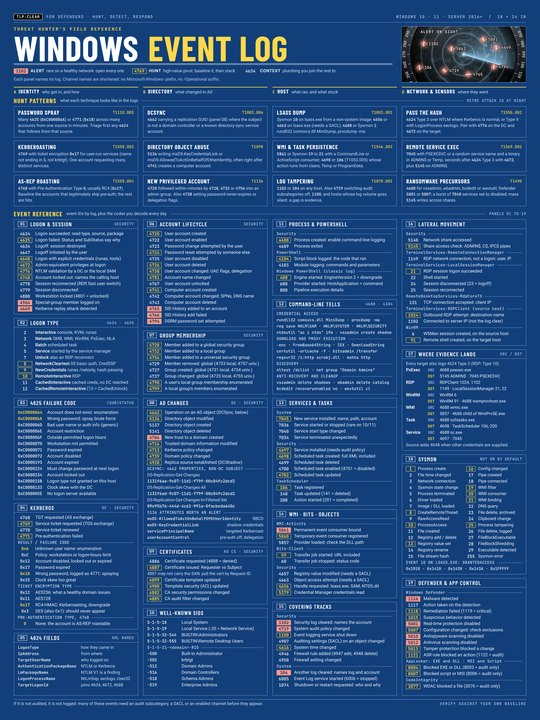</a> <b>04 · Blueprint</b> Drafting blue with yellow callouts. <a href="posters/18x24/Windows-Event-Log_04-Blueprint_18x24_300dpi.png">18×24</a> · <a href="posters/20x24/Windows-Event-Log_04-Blueprint_20x24_300dpi.png">20×24</a> · <a href="posters/20x30/Windows-Event-Log_04-Blueprint_20x30_300dpi.png">20×30</a></td><td align="center" width="25%"><a href="posters/18x24/Windows-Event-Log_05-Field-Manual_18x24_300dpi.png">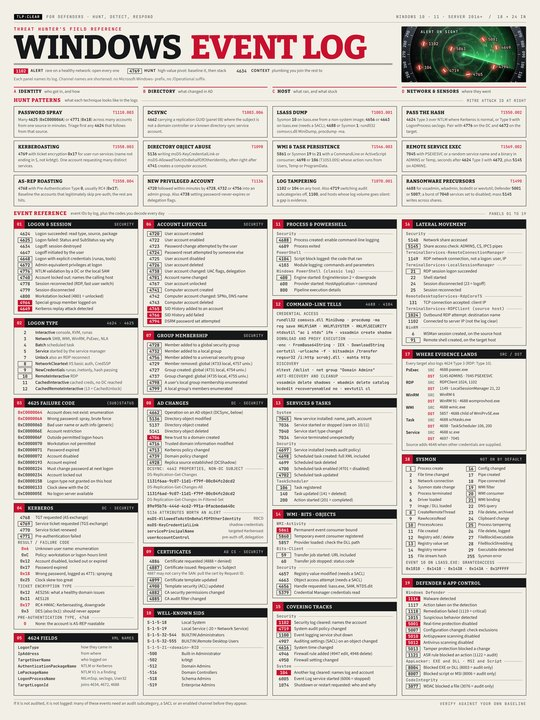</a> <b>05 · Field Manual</b> Off-white paper with red. Light on ink. <a href="posters/18x24/Windows-Event-Log_05-Field-Manual_18x24_300dpi.png">18×24</a> · <a href="posters/20x24/Windows-Event-Log_05-Field-Manual_20x24_300dpi.png">20×24</a> · <a href="posters/20x30/Windows-Event-Log_05-Field-Manual_20x30_300dpi.png">20×30</a></td><td align="center" width="25%"><a href="posters/18x24/Windows-Event-Log_06-Case-File_18x24_300dpi.png">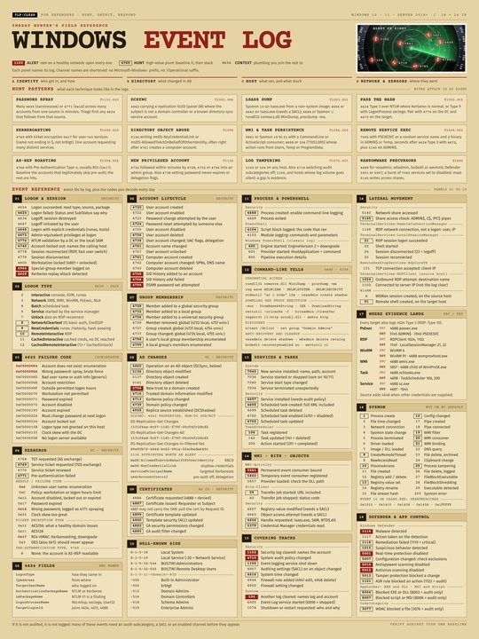</a> <b>06 · Case File</b> Manila folder and typewriter type. Light on ink. <a href="posters/18x24/Windows-Event-Log_06-Case-File_18x24_300dpi.png">18×24</a> · <a href="posters/20x24/Windows-Event-Log_06-Case-File_20x24_300dpi.png">20×24</a> · <a href="posters/20x30/Windows-Event-Log_06-Case-File_20x30_300dpi.png">20×30</a></td><td align="center" width="25%"><a href="posters/18x24/Windows-Event-Log_07-Night-Ops_18x24_300dpi.png">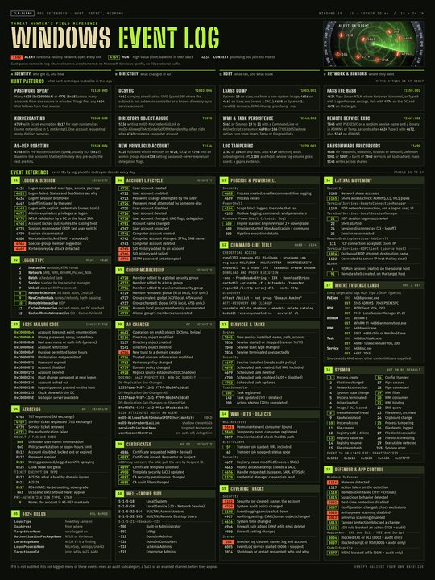</a> <b>07 · Night Ops</b> Night-vision green with sand titles. <a href="posters/18x24/Windows-Event-Log_07-Night-Ops_18x24_300dpi.png">18×24</a> · <a href="posters/20x24/Windows-Event-Log_07-Night-Ops_20x24_300dpi.png">20×24</a> · <a href="posters/20x30/Windows-Event-Log_07-Night-Ops_20x30_300dpi.png">20×30</a></td></tr>
<tr><td align="center" width="25%"><a href="posters/18x24/Windows-Event-Log_08-Neon-Grid_18x24_300dpi.png">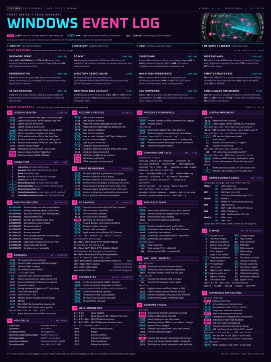</a> <b>08 · Neon Grid</b> Cyan and magenta on violet-black. <a href="posters/18x24/Windows-Event-Log_08-Neon-Grid_18x24_300dpi.png">18×24</a> · <a href="posters/20x24/Windows-Event-Log_08-Neon-Grid_20x24_300dpi.png">20×24</a> · <a href="posters/20x30/Windows-Event-Log_08-Neon-Grid_20x30_300dpi.png">20×30</a></td><td align="center" width="25%"><a href="posters/18x24/Windows-Event-Log_09-Arctic_18x24_300dpi.png">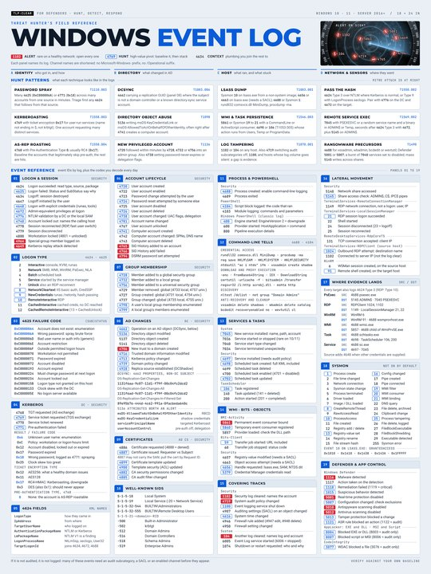</a> <b>09 · Arctic</b> Cool white with blue. Light on ink. <a href="posters/18x24/Windows-Event-Log_09-Arctic_18x24_300dpi.png">18×24</a> · <a href="posters/20x24/Windows-Event-Log_09-Arctic_20x24_300dpi.png">20×24</a> · <a href="posters/20x30/Windows-Event-Log_09-Arctic_20x30_300dpi.png">20×30</a></td><td align="center" width="25%"><a href="posters/18x24/Windows-Event-Log_10-Thermal_18x24_300dpi.png">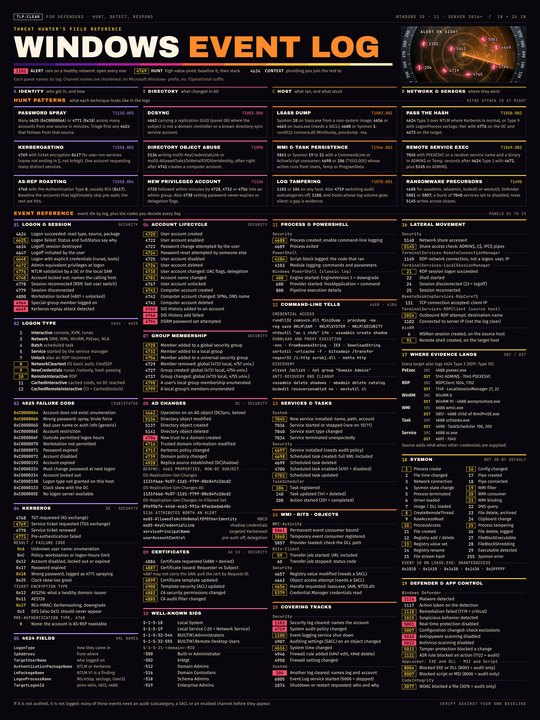</a> <b>10 · Thermal</b> Heat-map colours, one per column. <a href="posters/18x24/Windows-Event-Log_10-Thermal_18x24_300dpi.png">18×24</a> · <a href="posters/20x24/Windows-Event-Log_10-Thermal_20x24_300dpi.png">20×24</a> · <a href="posters/20x30/Windows-Event-Log_10-Thermal_20x30_300dpi.png">20×30</a></td><td align="center" width="25%"><a href="posters/18x24/Windows-Event-Log_11-Teal-Granite_18x24_300dpi.png">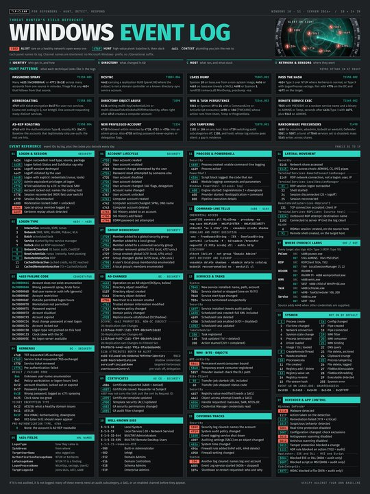</a> <b>11 · Teal Granite</b> Granite grey and black with teal. <a href="posters/18x24/Windows-Event-Log_11-Teal-Granite_18x24_300dpi.png">18×24</a> · <a href="posters/20x24/Windows-Event-Log_11-Teal-Granite_20x24_300dpi.png">20×24</a> · <a href="posters/20x30/Windows-Event-Log_11-Teal-Granite_20x30_300dpi.png">20×30</a></td></tr>
</table>

## Printing

Every file is a lossless PNG drawn at 300 dpi, in sRGB.

| Order this size | Use the file in | Pixels | What comes out |
|---|---|---|---|
| 18 × 24 in | `posters/18x24/` | 5400 × 7200 | The poster edge to edge, as designed. For any print shop that lists 18 × 24. |
| 20 × 24 in | `posters/20x24/` | 6000 × 7200 | The poster at exactly its 18 × 24 size, with 1 in of matching background left and right. Trim the sides to fit an 18 × 24 frame. |
| 20 × 30 in | `posters/20x30/` | 6000 × 9000 | The poster 11% larger (20 × 26.7 in), with a 1.7 in band of matching background above and below. |
| 24 × 36 in | `posters/20x30/` | 6000 × 9000 | The same file, one third larger than the original (24 × 32 in) with 2 in bands. Prints at 250 dpi. |

- **Walgreens and Sam's Club.** As of November 2026 neither lists 18 × 24 among its poster sizes. Both list 20 × 30 and 24 × 36, and Sam's Club also lists 20 × 24, so use a store-size file there. Uploading the 18 × 24 file to another size would crop it.
- **Before you pay,** check that the store's preview shows the whole sheet, from the top strip to the footer line, with nothing cut off.
- **Paper.** Matte hides glare on the dark themes. Field Manual, Case File and Arctic have light backgrounds and use far less ink.
- **Type size.** At 18 × 24 the event rows print at 10.5 pt and the smallest labels at 9 pt. At 24 × 36 that becomes 14 pt and 12 pt.

## What's on the sheet

Twelve hunt patterns across the top, then nineteen reference panels in four columns that follow an intrusion.

| A · Identity | B · Directory | C · Host | D · Network & sensors |
|---|---|---|---|
| who got in, and how | what changed in AD | what ran, and what stuck | where they went |
| 01 Logon & session | 06 Account lifecycle | 11 Process & PowerShell | 16 Lateral movement |
| 02 Logon type | 07 Group membership | 12 Command-line tells | 17 Where evidence lands |
| 03 4625 failure code | 08 AD changes | 13 Services & tasks | 18 Sysmon |
| 04 Kerberos | 09 Certificates | 14 WMI · BITS · objects | 19 Defender & app control |
| 05 4624 fields | 10 Well-known SIDs | 15 Covering tracks | |

**Hunt patterns:** password spray, DCSync, LSASS dump, pass the hash, Kerberoasting, directory object abuse, WMI & task persistence, remote service exec, AS-REP roasting, new privileged account, log tampering, ransomware precursors.

**Reading the event IDs:** a filled chip is an *alert* (rare on a healthy network: open every one), an outlined chip is a *hunt* pivot (baseline it, then stack), and a plain ID is *context* you join the rest to.

## Folders

| Path | Holds |
|---|---|
| `index.html` | The preview page |
| `posters/18x24/`, `posters/20x24/`, `posters/20x30/` | Print files, twelve themes each |
| `previews/` | 1080 × 1440 previews |
| `thumbs/` | 540 × 720 thumbnails |

## Notes

If it is not audited, it is not logged: many of these events need an audit subcategory, a SACL or an enabled channel before they appear. Verify every ID and field against your own environment.

An independent reference, not affiliated with or endorsed by Microsoft. Windows is a trademark of the Microsoft group of companies.
